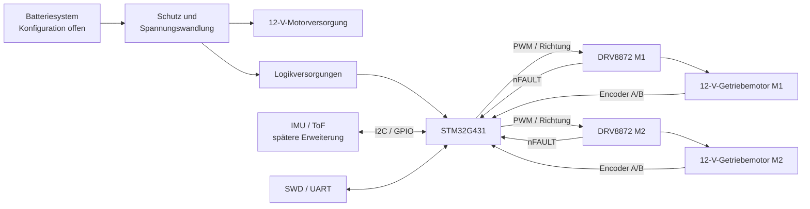

# Mini Rover

Ein STM32-basierter autonomer Rover, der als durchgängiges Portfolio-Projekt
für eingebettete Systeme entwickelt wird. Das Projekt verbindet eine eigene
KiCad-Platine, eine geregelte Gleichstrommotorsteuerung, Encoder-Rückführung,
Sensorintegration, eingebettete Firmware und eine 3D-gedruckte mechanische
Plattform.

> **Status:** Architektur- und Elektronikentwurf. Die Hardwarebasis ist
> dokumentiert, die Reserven von Motor, Stromversorgung und Thermik müssen
> jedoch vor der Platinenfertigung an einem Prüfstandsprototyp validiert werden.

## Projektziele

- Aufbau einer zuverlässigen Differentialantriebsplattform mit zwei unabhängig
  geregelten 12-V-Gleichstrom-Getriebemotoren.
- Entwicklung einer eigenen Controller-Platine auf Basis des STM32G431 mit zwei
  DRV8872-Motorstufen.
- Messung der Radbewegung mit Hall-Encodern in Quadraturausführung.
- Umsetzung einer sicheren, geschlossenen Drehzahlregelung mit deterministischer
  Fehlerreaktion.
- Erweiterbare elektrische und mechanische Architektur für IMU-, ToF- und
  weitere Navigationssensoren.
- Dokumentation von Anforderungen, Entscheidungen, Prüfungen und Ergebnissen,
  damit das Projekt reproduziert und begutachtet werden kann.

Autonome Navigation, SLAM, Kamera und Manipulator sind spätere Erweiterungen.
Sie gehören nicht zur ersten validierten Rover-Version.

## Systemübersicht



## Aktueller Entwurfsstand

| Bereich | Ausgangsbasis | Reifegrad |
| --- | --- | --- |
| Controller | STM32G431CBT6 auf einer eigenen Platine | Ausgewählt; Pinbelegung offen |
| Prototyp-Controller | NUCLEO-G431RB oder gleichwertiges G431-Board | Geplant |
| Motortreiber | 2 × DRV8872, ein Kanal pro Motor | Ausgewählt; Stromreserve offen |
| Motoren | 2 × 12-V-Metallgetriebemotoren der Klasse GA25/JGA25-370 mit AB-Hall-Encodern und etwa 100–130 U/min | Kandidat; vor Festlegung charakterisieren |
| Antriebskonzept | Differentialantrieb | Ausgewählt |
| Motorregelung | PWM/Richtung, Drehzahlschätzung per Encoder, PID-Drehzahlregelkreis | Geplant |
| Sensoren | IMU- und ToF-Erweiterung über I2C/GPIO | Nach Fertigstellung der Antriebsbasis geplant |
| Platinenwerkzeug | KiCad | In Bearbeitung |
| Mechanik | Eigenes 3D-gedrucktes Chassis | Konzeptphase |

## Projektstatus

| Arbeitsbereich | Status |
| --- | --- |
| Anforderungen und Architektur | In Bearbeitung |
| Prüfstandsprototyp | Nicht begonnen |
| Schaltplanerfassung | In Bearbeitung |
| Platinenlayout und Fertigung | Nicht begonnen |
| Firmware | Nicht begonnen |
| Mechanische Konstruktion | Nicht begonnen |
| Integrierte Verifikation | Nicht begonnen |

Die [Roadmap](docs/ROADMAP.md) definiert die Abschlusskriterien der einzelnen
Phasen. Der [Backlog](docs/BACKLOG.md) ist die verbindliche Planungsgrundlage
und verknüpft jedes Arbeitspaket mit dem zugehörigen GitHub-Issue.

## Repository-Struktur

```text
.
├── .github/             Vorlagen für Issues und Pull Requests
├── docs/                Architektur, Entwurf, Roadmap und Verifikation
├── firmware/            STM32-Firmware und zugehörige Dokumentation
├── hardware/            KiCad-Quellen, Stückliste und Fertigungsdaten
├── mechanical/          CAD-Quellen und Fertigungshinweise
```

## Dokumentation

- [Systemarchitektur](docs/ARCHITECTURE.md)
- [Elektronikentwurf](docs/ELECTRONICS.md)
- [Firmwarearchitektur](docs/FIRMWARE.md)
- [Verifikationsplan](docs/VERIFICATION.md)
- [Entscheidungsprotokoll](docs/DECISIONS.md)
- [Backlog](docs/BACKLOG.md)
- [Roadmap](docs/ROADMAP.md)
- [Beitragsrichtlinien](CONTRIBUTING.md)

## Sicherheitshinweis

Der Rover enthält bewegte Antriebsteile und kann mit Akkus betrieben werden,
die hohe Ströme liefern. Erste Inbetriebnahmen müssen mit strombegrenztem
Labornetzteil, mechanisch gesichertem Antrieb und leicht erreichbarer
Abschaltmöglichkeit erfolgen. Motoren dürfen nur im Rahmen einer festgelegten
Prüfanweisung blockiert werden.

## Lizenz

Derzeit wurde keine Open-Source-Lizenz festgelegt. Ohne ausdrückliche Lizenz
werden keine Nutzungs-, Änderungs- oder Weiterverbreitungsrechte eingeräumt.
