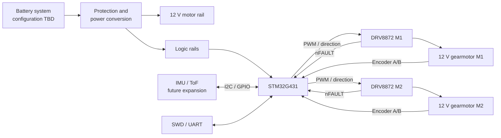

# Mini Rover

An STM32-based autonomous rover developed as an end-to-end embedded systems
portfolio project. The project combines a custom KiCad PCB, closed-loop DC
motor control, encoder feedback, sensor integration, embedded firmware, and a
3D-printed mechanical platform.

> **Status:** architecture and electronics design. The hardware baseline is
> documented, but the motor, power, and thermal margins must be validated on a
> bench prototype before PCB fabrication.

## Project goals

- Build a reliable differential-drive platform with two independently
  controlled 12 V DC gearmotors.
- Design a custom STM32G431-based controller PCB with two DRV8872 motor stages.
- Measure wheel motion with quadrature Hall encoders.
- Implement safe closed-loop speed control and a deterministic fault response.
- Keep the electrical and mechanical architecture extensible for IMU, ToF, and
  other navigation sensors.
- Document requirements, decisions, tests, and results so that the project can
  be reproduced and reviewed.

Autonomous navigation, SLAM, a camera, and a manipulator are future extensions.
They are not part of the first validated rover release.

## System overview



## Current design baseline

| Area | Baseline | Maturity |
| --- | --- | --- |
| Controller | STM32G431CBT6 on a custom PCB | Selected; pin map pending |
| Prototype controller | NUCLEO-G431RB or equivalent G431 board | Planned |
| Motor drivers | 2 × DRV8872, one channel per motor | Selected; current margin pending |
| Motors | 2 × 12 V GA25/JGA25-370 class gearmotors with AB Hall encoders, approximately 100–130 rpm | Candidate; characterize before freeze |
| Drive model | Differential drive | Selected |
| Motor control | PWM/direction, encoder speed estimation, PID speed loop | Planned |
| Sensors | IMU and ToF expansion over I2C/GPIO | Planned after drive base |
| PCB tool | KiCad | In progress |
| Mechanics | Custom 3D-printed chassis | Concept phase |

## Project status

| Workstream | Status |
| --- | --- |
| Requirements and architecture | In progress |
| Bench prototype | Initial Hall encoder measurements recorded; calibration pending |
| Schematic capture | In progress |
| PCB layout and fabrication | Not started |
| Firmware | Not started |
| Mechanical design | Not started |
| Integrated verification | Not started |

The [roadmap](docs/ROADMAP.md) defines phase exit criteria. The
[backlog](docs/BACKLOG.md) is the planning source of truth and links every work
package to its GitHub Issue.

### First Hall encoder measurements

The [initial measurement report](docs/HALLENCODER_FIRST_MEASUREMENTS.md)
records the supplied Arduino bench sketch, X4 quadrature decoding, and serial
output approaching -112 RPM with a provisional 3894 counts/revolution factor.
The factor and its reference shaft still require calibration; this is not yet
validation of both motors or the planned STM32 implementation (MR-002).

## Repository structure

```text
.
├── .github/             Issue and pull-request templates
├── docs/                Architecture, design, roadmap, and verification
├── firmware/            STM32 firmware and firmware-specific documentation
├── hardware/            KiCad sources, BOM, and manufacturing outputs
├── mechanical/          CAD sources and manufacturing notes
├── CONTRIBUTING.md      Engineering workflow and Definition of Done
└── README.md            Project entry point
```

Directories currently contain documentation placeholders. Design sources will
be added only when they exist; generated build and editor artifacts are ignored.

## Start here

1. Read the [architecture](docs/ARCHITECTURE.md) and
   [decision log](docs/DECISIONS.md).
2. Review the electrical assumptions in [electronics](docs/ELECTRONICS.md).
3. Select the next work item from the [backlog](docs/BACKLOG.md).
4. Use the [verification plan](docs/VERIFICATION.md) before accepting hardware
   or firmware changes.

Do not order the custom PCB until the P0 bench-validation tasks and the
schematic review exit criteria are complete.

## Engineering workflow

Every material change should start from a GitHub Issue and include:

- a defined problem and acceptance criteria;
- links to affected requirements or decisions;
- reviewable source files rather than only exported binaries;
- verification evidence for hardware or behavior changes;
- updated documentation when an interface or assumption changes.

See [CONTRIBUTING.md](CONTRIBUTING.md) for branch, commit, review, and Definition
of Done conventions.

## Known project risks

- Generic GA25/JGA25-370 motors vary significantly in stall current and encoder
  characteristics.
- The DRV8872 electrical and thermal margin has not yet been demonstrated with
  the selected motor.
- Battery topology, charging, protection, and logic-rail conversion are not yet
  frozen.
- MCU pin multiplexing and timer allocation can constrain later encoder, PWM,
  and sensor interfaces.
- PCB fabrication before bench validation would make early design errors costly.

## License

No project license has been selected yet. Until a license file is added, no
permission to copy, modify, or redistribute the project is granted.
