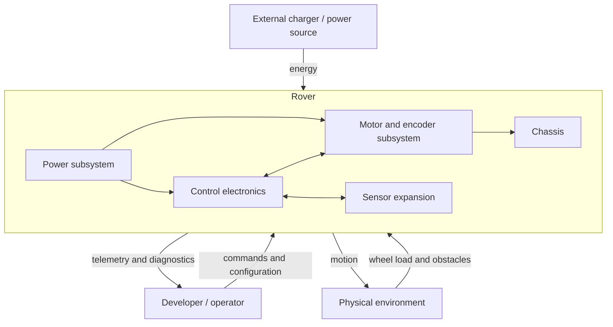

# System Architecture

## Purpose

The Mini Rover is a small differential-drive robot used to develop and
demonstrate embedded hardware, real-time firmware, feedback control, PCB design,
and mechanical integration. The first system release focuses on a dependable
drive base; navigation features are layered on only after the base is verified.

## Architectural principles

1. **Validate before integrating.** Motor, driver, encoder, and power behavior
   are measured on the bench before the custom PCB is released.
2. **Fail safe.** A detected driver, supply, or firmware fault must disable
   torque in a deterministic way.
3. **Separate concerns.** Hardware access, estimation, control, safety, and
   application behavior remain independently testable firmware layers.
4. **Keep evidence.** Decisions and phase completion require measurements,
   reports, or reproducible tests.
5. **Design for extension.** Sensor and debug interfaces are reserved without
   making future features a dependency of the first drive-base release.

## System context

## Subsystems

### Power subsystem

Accepts energy from the selected battery system, protects the rover against
credible electrical faults, and supplies the 12 V motor domain and required
logic rails. Battery topology and detailed conversion architecture are open
design decisions.

### Control electronics

An STM32G431 provides PWM generation, direction control, encoder capture,
fault monitoring, control-loop execution, communications, and system safety.
The custom PCB includes two DRV8872 motor channels plus programming and debug
interfaces.

### Drive subsystem

Two independently controlled 12 V metal gearmotors drive the left and right
sides. AB Hall encoders provide quadrature feedback for speed estimation and
later odometry. Exact motor constants must be measured because generic motor
listings are not a reliable engineering specification.

### Sensor expansion

IMU and ToF sensors are planned after the drive base is stable. The first PCB
should reserve suitable I2C, GPIO, interrupt, power, and mechanical interfaces,
but the rover must be able to drive and stop safely without these sensors.

### Mechanical subsystem

The chassis locates motors, wheels, battery, PCB, connectors, and future sensor
mounts. It must allow service access, strain relief, cooling, and safe battery
retention.

## Principal interfaces

| Interface | Producer | Consumer | Notes |
| --- | --- | --- | --- |
| `M1_IN1`, `M1_IN2` | STM32 | DRV8872 M1 | PWM/direction control |
| `M2_IN1`, `M2_IN2` | STM32 | DRV8872 M2 | PWM/direction control |
| `M1_FAULT`, `M2_FAULT` | DRV8872 | STM32 | Active-low, correctly pulled up |
| `ENC1_A/B`, `ENC2_A/B` | Motor encoders | STM32 timers | Quadrature capture preferred |
| SWD | Debug probe | STM32 | Programming and debugging |
| UART | STM32 | Development host | Logs, test commands, telemetry |
| I2C | STM32 | IMU/ToF devices | Expansion; pull-ups and bus voltage TBD |
| Motor rail | Power subsystem | DRV8872 stages | Nominal 12 V design domain |
| Logic rails | Power subsystem | MCU and sensors | Voltages and current budget TBD |

## Control and data flow

1. Firmware samples encoder counters and fault inputs.
2. Speed estimation converts count deltas into wheel angular velocity.
3. The control layer compares target and measured speeds.
4. A bounded PID controller produces motor commands.
5. The hardware layer applies direction and PWM to each driver.
6. The safety supervisor can override both motor commands and disable torque.
7. Telemetry reports commands, measurements, limits, and faults.

## Quality attributes

- **Safety:** loss of valid control or a reported driver fault leads to a stop.
- **Testability:** each motor channel can be exercised independently on a bench.
- **Traceability:** backlog items link design work to acceptance criteria.
- **Maintainability:** interfaces and decisions are documented with the source.
- **Reproducibility:** BOM entries include manufacturer part numbers or measured
  substitutes, not only marketplace product titles.
- **Observability:** SWD and structured UART telemetry remain available during
  bring-up.

## Open architectural decisions

- battery chemistry, cell count, charging strategy, and protection;
- final motor part number and measured electrical model;
- logic-rail topology and current budgets;
- exact STM32 pin and timer assignment;
- firmware build system and HAL/LL split;
- chassis dimensions, wheel diameter, and gear ratio;
- sensor connector and voltage standard.

These decisions are tracked in [DECISIONS.md](DECISIONS.md) and
[BACKLOG.md](BACKLOG.md).

