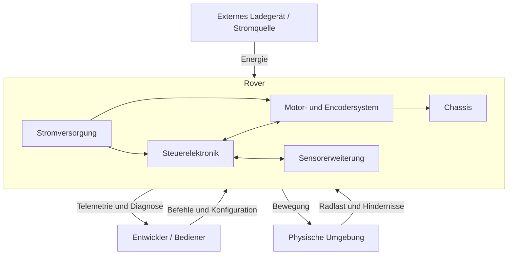

# Systemarchitektur

## Zweck

Der Mini Rover ist ein kleiner Roboter mit Differentialantrieb zur Entwicklung
und Demonstration von eingebetteter Hardware, Echtzeit-Firmware,
Rückkopplungsregelung, Platinenentwicklung und mechanischer Integration. Die
erste Systemversion konzentriert sich auf eine zuverlässige Antriebsbasis;
Navigationsfunktionen werden erst ergänzt, nachdem diese Basis verifiziert ist.

## Architekturprinzipien

1. **Vor der Integration validieren.** Das Verhalten von Motor, Treiber,
   Encoder und Stromversorgung wird am Prüfstand gemessen, bevor die eigene
   Platine freigegeben wird.
2. **Sicher ausfallen.** Ein erkannter Treiber-, Versorgungs- oder
   Firmwarefehler muss das Drehmoment deterministisch abschalten.
3. **Verantwortlichkeiten trennen.** Hardwarezugriff, Zustandsschätzung,
   Regelung, Sicherheit und Anwendungsverhalten bleiben unabhängig prüfbare
   Firmware-Schichten.
4. **Nachweise erhalten.** Entscheidungen und Phasenabschlüsse erfordern
   Messungen, Berichte oder reproduzierbare Prüfungen.
5. **Erweiterbarkeit vorsehen.** Sensor- und Debug-Schnittstellen werden
   reserviert, ohne zukünftige Funktionen zur Voraussetzung der ersten
   Antriebsbasis-Version zu machen.

## Systemkontext

## Teilsysteme

### Stromversorgung

Nimmt Energie aus dem ausgewählten Batteriesystem auf, schützt den Rover gegen
plausible elektrische Fehler und versorgt den 12-V-Motorbereich sowie die
erforderlichen Logikspannungen. Batterietopologie und detaillierte
Wandlerarchitektur sind noch offene Entwurfsentscheidungen.

### Steuerelektronik

Ein STM32G431 erzeugt die PWM-Signale, steuert die Richtung, erfasst die
Encoder, überwacht Fehler, führt die Regelkreise und die Systemsicherheit aus
und übernimmt die Kommunikation. Die eigene Platine enthält zwei
DRV8872-Motorkanäle sowie Programmier- und Debug-Schnittstellen.

### Antriebssystem

Zwei unabhängig geregelte 12-V-Metallgetriebemotoren treiben die linke und
rechte Seite an. AB-Hall-Encoder liefern Quadraturrückführung für die
Drehzahlschätzung und spätere Odometrie. Die genauen Motorkonstanten müssen
gemessen werden, da allgemeine Marktplatzangebote keine verlässliche technische
Spezifikation darstellen.

### Sensorerweiterung

IMU- und ToF-Sensoren sind vorgesehen, sobald die Antriebsbasis stabil arbeitet.
Die erste Platine soll geeignete I2C-, GPIO-, Interrupt-, Stromversorgungs- und
mechanische Schnittstellen reservieren. Der Rover muss jedoch auch ohne diese
Sensoren sicher fahren und anhalten können.

### Mechanisches System

Das Chassis positioniert Motoren, Räder, Batterie, Platine, Steckverbinder und
künftige Sensorhalterungen. Es muss Wartungszugang, Zugentlastung, Kühlung und
eine sichere Batteriebefestigung ermöglichen.

## Zentrale Schnittstellen

| Schnittstelle | Erzeuger | Verbraucher | Hinweise |
| --- | --- | --- | --- |
| `M1_IN1`, `M1_IN2` | STM32 | DRV8872 M1 | PWM-/Richtungssteuerung |
| `M2_IN1`, `M2_IN2` | STM32 | DRV8872 M2 | PWM-/Richtungssteuerung |
| `M1_FAULT`, `M2_FAULT` | DRV8872 | STM32 | Aktiv-low, korrekt hochgezogen |
| `ENC1_A/B`, `ENC2_A/B` | Motorencoder | STM32-Timer | Quadraturerfassung bevorzugt |
| SWD | Debug-Probe | STM32 | Programmierung und Fehlersuche |
| UART | STM32 | Entwicklungsrechner | Protokolle, Prüfbefehle und Telemetrie |
| I2C | STM32 | IMU-/ToF-Geräte | Erweiterung; Pull-ups und Busspannung offen |
| Motorversorgung | Stromversorgung | DRV8872-Stufen | Nomineller 12-V-Auslegungsbereich |
| Logikversorgungen | Stromversorgung | MCU und Sensoren | Spannungen und Strombudget offen |

## Steuerungs- und Datenfluss

1. Die Firmware liest Encoderzähler und Fehlereingänge ein.
2. Die Drehzahlschätzung wandelt Zählerdifferenzen in Radwinkelgeschwindigkeiten um.
3. Die Regelung vergleicht Soll- und Ist-Drehzahlen.
4. Ein begrenzter PID-Regler erzeugt die Motorbefehle.
5. Die Hardwareebene legt Richtung und PWM an den jeweiligen Treiber an.
6. Die Sicherheitsüberwachung kann beide Motorbefehle übersteuern und das Drehmoment abschalten.
7. Die Telemetrie meldet Befehle, Messwerte, Grenzwerte und Fehler.

## Qualitätsmerkmale

- **Sicherheit:** Der Verlust einer gültigen Steuerung oder ein gemeldeter
  Treiberfehler führt zum Stillstand.
- **Prüfbarkeit:** Jeder Motorkanal kann auf dem Prüfstand separat betrieben werden.
- **Nachvollziehbarkeit:** Backlog-Einträge verknüpfen Entwurfsarbeiten mit Abnahmekriterien.
- **Wartbarkeit:** Schnittstellen und Entscheidungen werden gemeinsam mit den Quellen dokumentiert.
- **Reproduzierbarkeit:** Stücklisteneinträge enthalten Herstellerteilenummern oder gemessene Ersatzteile und nicht nur Produktnamen von Marktplätzen.
- **Beobachtbarkeit:** SWD und strukturierte UART-Telemetrie bleiben während der Inbetriebnahme zugänglich.

## Offene Architekturentscheidungen

- Batteriechemie, Zellenzahl, Ladestrategie und Schutz;
- endgültige Motorteilenummer und gemessenes elektrisches Modell;
- Topologie der Logikspannungen und Strombudgets;
- genaue STM32-Pin- und Timerzuordnung;
- Firmware-Buildsystem und Aufteilung zwischen HAL und LL;
- Chassisabmessungen, Raddurchmesser und Übersetzungsverhältnis;
- Sensorsteckverbinder und Spannungsstandard.

Diese Entscheidungen werden in [DECISIONS.md](DECISIONS.md) und
[BACKLOG.md](BACKLOG.md) nachverfolgt.
