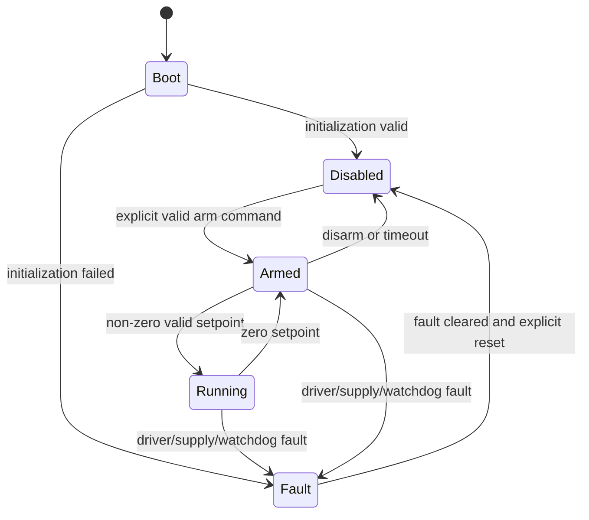

# Firmware Architecture

## Objectives

The firmware must control two motor channels deterministically, capture encoder
feedback, execute bounded speed controllers, report diagnostics, and remove
torque safely when a fault or invalid operating state is detected.

The source tree does not yet contain production firmware. This document defines
the intended boundaries before implementation begins.

## Proposed layering

```text
application/     drive modes, commands, future autonomy integration
control/         speed setpoints, PID, saturation, anti-windup
estimation/      encoder delta processing, speed and odometry estimates
safety/          state machine, watchdogs, fault latching, safe stop
drivers/         motor driver, encoder timer, UART, I2C, GPIO
platform/        clocks, board support, HAL/LL adaptation, startup
tests/           host-side unit tests and target integration tests
```

Application and control code must not write MCU registers directly. Target-
specific code stays behind small interfaces so that algorithms can be tested on
a host where practical.

## Runtime model

The initial firmware uses a fixed-rate control cycle. Exact rates are selected
from measurement, but the design records:

- control-loop period and worst-case execution time;
- encoder sampling interval and overflow behavior;
- command timeout;
- telemetry rate and back-pressure behavior;
- watchdog period and recovery behavior.

Interrupts should capture time-critical events and update bounded state only.
Formatting, protocol handling, and slow sensor work do not belong in critical
interrupt paths.

## Safety state machine



Motor outputs default to the disabled state during reset and initialization.
The safety supervisor has final authority over both motor commands.

## Planned modules

| Module | Responsibility | Initial acceptance evidence |
| --- | --- | --- |
| Board support | Clocks, pins, timers, debug UART | Boot log and pin-map review |
| Motor driver | Direction, PWM, stop mode, fault input | Truth-table target test |
| Encoder | Quadrature count and delta capture | Direction and maximum-speed test |
| Speed estimator | Counts to physical units | Logged comparison to reference |
| PID controller | Bounded wheel-speed control | Step-response report |
| Safety supervisor | States, timeouts, latched faults | Fault-injection tests |
| Telemetry | Timestamped commands and measurements | Machine-readable capture |

## Coding rules

- Use explicit physical units in identifiers or types where ambiguity is likely.
- Keep interrupt handlers bounded and non-blocking.
- Check and propagate initialization failures.
- Bound every actuator command.
- Avoid dynamic allocation in the steady-state control path.
- Document hardware assumptions next to the board configuration.
- Treat compiler warnings as defects unless a warning is narrowly justified.

## Toolchain decision

The final build and dependency approach is still open. STM32CubeIDE is suitable
for early target bring-up; a reproducible command-line build and automated host
tests are preferred for the maintained project. The selected approach must
document compiler version, generated-code boundaries, formatting, static
analysis, and CI behavior.

## Verification strategy

1. Unit-test mathematical and state-machine logic on a host.
2. Test each low-level driver on the Nucleo bench setup.
3. Capture structured telemetry for motor and encoder tests.
4. Inject driver faults, command loss, counter overflow, and invalid inputs.
5. Repeat target tests on the custom PCB during bring-up.
6. Store summarized evidence with the relevant issue or test report.

