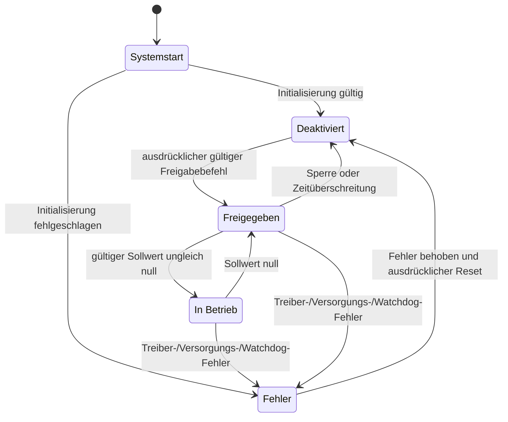

# Firmwarearchitektur

## Ziele

Die Firmware muss zwei Motorkanäle deterministisch steuern, Encoderrückführung
erfassen, begrenzte Drehzahlregler ausführen, Diagnosedaten melden und bei einem
Fehler oder ungültigen Betriebszustand das Drehmoment sicher abschalten.

Der Quellbaum enthält noch keine produktive Firmware. Dieses Dokument legt die
vorgesehenen Grenzen fest, bevor die Implementierung beginnt.

## Vorgeschlagene Schichten

```text
application/     Fahrmodi, Befehle, spätere Autonomieintegration
control/         Drehzahlsollwerte, PID, Sättigung, Anti-Windup
estimation/      Encoderdifferenzen, Drehzahl- und Odometrieschätzung
safety/          Zustandsautomat, Watchdogs, Fehlerspeicherung, sicherer Stopp
drivers/         Motortreiber, Encoder-Timer, UART, I2C, GPIO
platform/        Takte, Boardunterstützung, HAL-/LL-Anpassung, Systemstart
tests/           Host-seitige Unit-Tests und Integrationstests auf dem Zielsystem
```

Anwendungs- und Regelungscode darf nicht direkt in MCU-Register schreiben.
Zielspezifischer Code bleibt hinter kleinen Schnittstellen verborgen, damit
Algorithmen nach Möglichkeit auf einem Entwicklungsrechner getestet werden können.

## Laufzeitmodell

Die erste Firmware verwendet einen Regelzyklus mit fester Rate. Die genauen
Raten werden anhand von Messungen festgelegt. Dokumentiert werden:

- Regelzyklusdauer und ungünstigste Ausführungszeit;
- Encoder-Abtastintervall und Überlaufverhalten;
- Befehlszeitüberschreitung;
- Telemetrierate und Verhalten bei Rückstau;
- Watchdog-Zeit und Wiederanlaufverhalten.

Interrupts sollen nur zeitkritische Ereignisse erfassen und begrenzte Zustände
aktualisieren. Formatierung, Protokollverarbeitung und langsame Sensoraufgaben
gehören nicht in kritische Interruptpfade.

## Sicherheitszustandsautomat



Während Reset und Initialisierung sind die Motorausgänge standardmäßig
deaktiviert. Die Sicherheitsüberwachung hat die letzte Entscheidungsgewalt über
beide Motorbefehle.

## Geplante Module

| Modul | Verantwortung | Anfänglicher Abnahmenachweis |
| --- | --- | --- |
| Boardunterstützung | Takte, Pins, Timer, Debug-UART | Startprotokoll und Prüfung der Pinbelegung |
| Motortreiber | Richtung, PWM, Stoppmodus, Fehlereingang | Prüfung der Wahrheitstabelle am Zielsystem |
| Encoder | Quadraturzählung und Differenzerfassung | Richtungs- und Höchstdrehzahltest |
| Drehzahlschätzung | Zählwerte in physikalische Einheiten umrechnen | Protokollierter Vergleich mit Referenz |
| PID-Regler | Begrenzte Raddrehzahlregelung | Bericht zur Sprungantwort |
| Sicherheitsüberwachung | Zustände, Zeitüberschreitungen, gespeicherte Fehler | Fehlerinjektionstests |
| Telemetrie | Befehle und Messwerte mit Zeitstempeln | Maschinenlesbare Aufzeichnung |

## Programmierrichtlinien

- Eindeutige physikalische Einheiten in Bezeichnern oder Typen verwenden, wenn Verwechslungen möglich sind.
- Interruptroutinen begrenzt und nicht blockierend halten.
- Initialisierungsfehler prüfen und weitergeben.
- Jeden Aktuatorbefehl begrenzen.
- Im stationären Regelpfad auf dynamische Speicherzuweisung verzichten.
- Hardwareannahmen unmittelbar an der Boardkonfiguration dokumentieren.
- Compilerwarnungen als Fehler behandeln, sofern sie nicht eng begrenzt begründet sind.

## Entscheidung zur Werkzeugkette

Der endgültige Build- und Abhängigkeitsansatz ist noch offen. STM32CubeIDE
eignet sich für die frühe Inbetriebnahme am Zielsystem. Für das dauerhaft
gepflegte Projekt werden ein reproduzierbarer Kommandozeilen-Build und
automatisierte Host-Tests bevorzugt. Der gewählte Ansatz muss Compilerversion,
Grenzen des generierten Codes, Formatierung, statische Analyse und CI-Verhalten
dokumentieren.

## Verifikationsstrategie

1. Mathematische Logik und Zustandsautomaten auf einem Entwicklungsrechner mit Unit-Tests prüfen.
2. Jeden Low-Level-Treiber am Nucleo-Prüfaufbau testen.
3. Strukturierte Telemetrie für Motor- und Encodertests aufzeichnen.
4. Treiberfehler, Befehlsverlust, Zählerüberlauf und ungültige Eingaben künstlich auslösen.
5. Zielsystemtests während der Inbetriebnahme auf der eigenen Platine wiederholen.
6. Zusammengefasste Nachweise beim zugehörigen Issue oder Prüfbericht ablegen.
